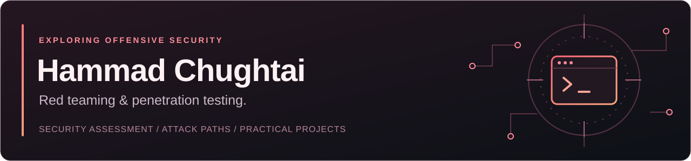

I'm Hammad, and I'm passionate about cybersecurity. My main interests are red teaming and penetration testing: understanding weaknesses, testing defenses, and exploring how systems can be better protected.

I want the things I work on to be useful, understandable, and honest about their limits.

## Work I'm exploring

**SENTINEL · Industrial & IoT security**

A collaborative research prototype combining behavioral trust scoring, isolated deception sessions, and cryptographic authorization for industrial control commands.

**[LogWatch](https://github.com/Hammad-Chughtai/LogWatch) · Authentication analysis**

An offline Python tool for investigating cloud and SSH login activity. It turns suspicious patterns into HTML and JSON reports with evidence to review.

**[ENABLE](https://github.com/Hammad-Chughtai/enable-p7-) · Accessible technology**

A project exploring how university digital systems can work better for neurodiverse students through more accessible interfaces.

## Tools used in these projects

Python · scikit-learn · GitHub Actions · Modbus/TCP · OpenPLC · HTML · CSS · JavaScript

---

Practical work. Clear explanations. Respect for privacy.
